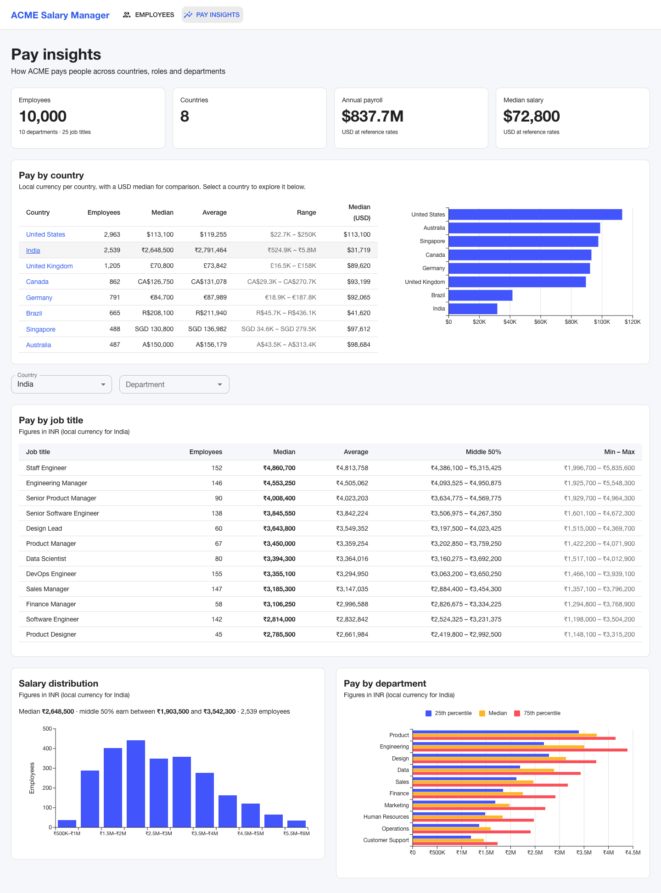
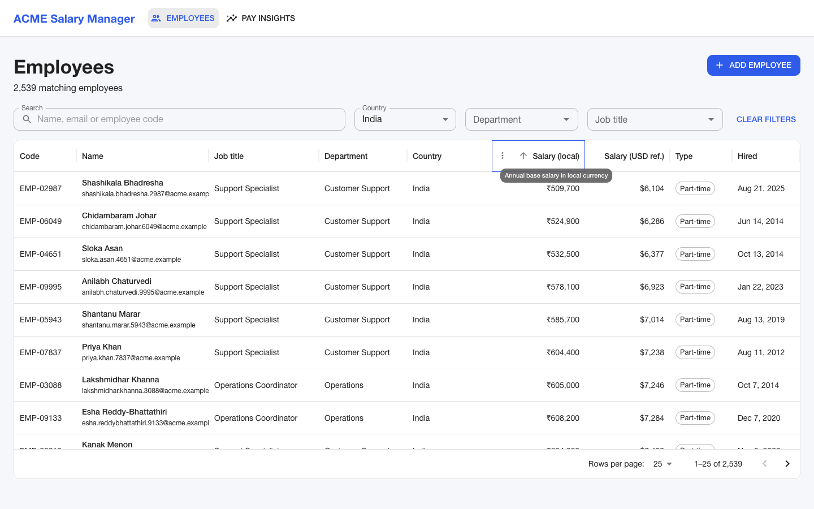
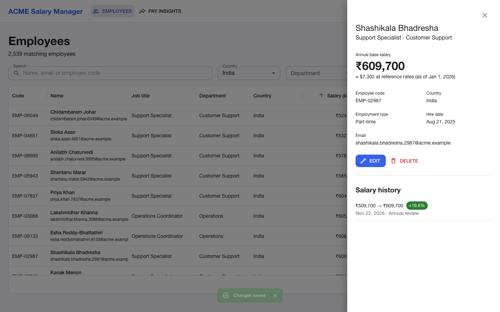

# ACME Salary Manager

A web app for ACME's HR team to manage salary data for **10,000 employees across 8 countries**, and to answer questions about how the organization pays people. It replaces a set of Excel files.

- **Backend:** Node 24 · Express 5 · TypeScript · Prisma · SQLite · Zod
- **Frontend:** React 19 · Vite · TypeScript · MUI (DataGrid, Charts) · TanStack Query · React Hook Form
- **Tests:** Vitest · Supertest · Testing Library · Mock Service Worker (113 backend + 48 frontend, all running in seconds)



## What it does

**Manage salaries**
- Directory of all employees with server-side paging, search (name, email or code), and filters by country, department and job title. Filters live in the URL, so views can be bookmarked and shared.
- Add, edit and delete employees with validation. Currency always follows the country.
- Every salary change is recorded automatically with an optional reason, shown as a history with percentage change.
- Guardrails: moving an employee to a country with a different currency requires a new salary, and salaries can only be sorted within one country.

**Understand pay**
- Headcount, annual payroll and median salary.
- Pay by country: median, average and range in local currency, plus a USD median for comparison.
- Pay by job title ("what do we pay a Staff Engineer in India?"): median, middle 50% and min–max.
- Salary distribution and pay by department, for any country/department filter.

| Directory | Salary history |
|---|---|
|  |  |

## Quick start

Requires **Node 24** (`nvm use` reads `.nvmrc`).

```bash
# 1. API on http://localhost:4000
cd backend
cp .env.example .env
npm install
npm run setup      # apply migrations + seed 10,000 employees (< 1 s)
npm run dev

# 2. Web app on http://localhost:5173 (in a second terminal)
cd frontend
npm install
npm run dev
```

Open <http://localhost:5173>. The Vite dev server proxies `/api` to the backend, so no CORS setup is needed.

Re-seed at any time with `npm run db:seed -- --reset` (in `backend/`). The seed is deterministic: the same 10,000 employees every time.

## Scripts

| | `backend/` | `frontend/` |
|---|---|---|
| Dev server | `npm run dev` | `npm run dev` |
| Tests | `npm test` · `npm run test:coverage` | `npm test` · `npm run test:coverage` |
| Lint / types | `npm run lint` · `npm run typecheck` | `npm run lint` · `npm run typecheck` |
| Production build | `npm run build && npm start` | `npm run build && npm run preview` |
| Database | `npm run setup` · `npm run db:seed -- --reset` · `npm run db:migrate` | – |

CI (`.github/workflows/ci.yml`) runs lint, typecheck, tests with coverage, and build for both apps.

## API overview

All endpoints are under `/api/v1`. Errors always have the shape `{ "error": { "code", "message", "details?" } }`.

| Method | Path | Purpose |
|---|---|---|
| GET | `/employees` | Paginated list: `page`, `pageSize` (≤100), `search`, `country`, `department`, `jobTitle`, `sortBy`, `sortOrder` |
| GET | `/employees/:id` | Employee with salary history |
| POST | `/employees` | Create (currency and employee code assigned by the server) |
| PATCH | `/employees/:id` | Partial update; `salaryChangeReason` is recorded with a salary change |
| DELETE | `/employees/:id` | Delete (cascades to history) |
| GET | `/insights/summary` | Org-wide headcount, payroll, median (USD) |
| GET | `/insights/by-country` | Per-country stats in local currency plus USD |
| GET | `/insights/by-job-title` | Per-title stats; `country` / `department` filters |
| GET | `/insights/by-department` | Per-department stats; `country` filter |
| GET | `/insights/distribution` | Histogram plus stats; `country` / `department` / `jobTitle`, `buckets` |
| GET | `/meta` | Countries, departments, job titles, employment types, FX reference rates |

## Project structure

```
backend/    Express API — routes → controllers → services → repositories, pure domain/ functions
frontend/   React SPA — api/ client, hooks/, features/employees, features/insights
docs/       requirements, architecture, decisions, performance, testing, AI usage, demo script
```

## Documentation

| Doc | Contents |
|---|---|
| [01 Requirements](docs/01-requirements.md) | One-page goal, persona, scope, roadmap, success criteria |
| [02 Architecture](docs/02-architecture.md) | System and layer diagrams, data model, request flow, code map |
| [03 Decisions](docs/03-decisions.md) | ADRs with trade-offs (SQLite, currency handling, insights computation, …) |
| [04 Performance](docs/04-performance.md) | Measured latencies on 10k employees, what makes it fast, scaling path |
| [05 Testing strategy](docs/05-testing-strategy.md) | Test layers, determinism, what isn't tested and why |
| [06 AI usage](docs/06-ai-usage.md) | How AI tools were used, prompts, and where output was corrected |
| [07 Demo script](docs/07-demo-script.md) | Walkthrough for the demo video |

## Roadmap

- **Phase 2:** authentication and role-based access; bulk Excel import and export.
- **Phase 3:** live FX rates; pay-equity analytics (after privacy review); bonuses, equity and approval workflows.

See the [requirements doc](docs/01-requirements.md) for details.
