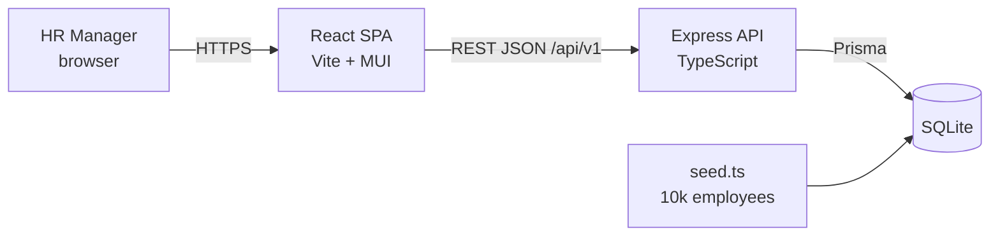
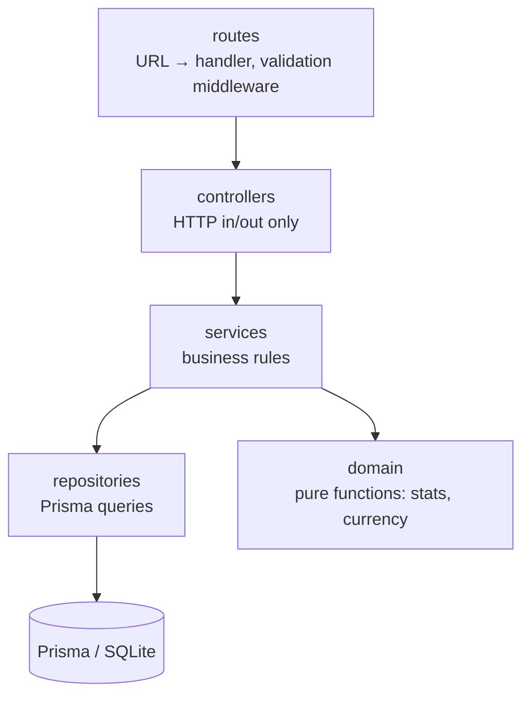
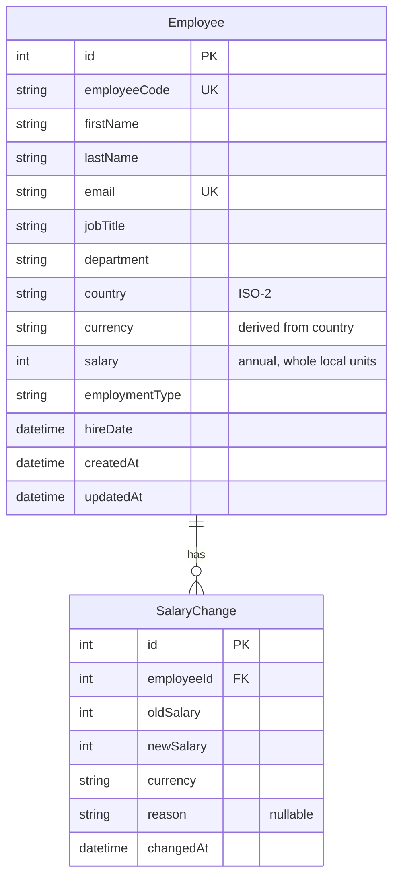
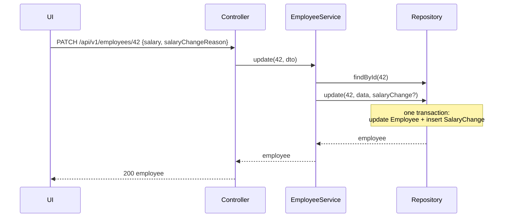

# Architecture

## System overview



There are two independently built apps, `frontend/` and `backend/`. They communicate only through a versioned REST API. Neither imports code from the other, so either one can be changed or replaced without touching the other.

## Backend layers



| Layer | Responsibility | Knows about HTTP? | Knows about DB? |
|---|---|---|---|
| routes | Wiring, zod request validation | yes | no |
| controllers | Map request → service call → response | yes | no |
| services | Rules (currency derived from country, salary history on change, not-found handling) | no | no (uses repository interface) |
| repositories | Queries, transactions, aggregation | no | yes |
| domain | Pure math: median, percentiles, histogram, FX conversion | no | no |

Services depend on a repository *interface*, so unit tests can use an in-memory fake. The real Prisma repository is covered by integration tests against a temporary SQLite file.

`createApp(deps)` builds the Express app without starting a server. `server.ts` only calls `listen`. That split keeps tests free of sockets.

## Data model



Indexes: `country`, `(country, jobTitle)`, `department`, `jobTitle`, `lastName`, `SalaryChange(employeeId)`.

## Request flow: updating a salary



## Frontend structure

- `api/`: a typed axios client plus one module per resource. This is the only code that knows URLs.
- `features/employees`, `features/insights`: page-level components for each feature.
- `hooks/`: TanStack Query hooks. Server state is cached and invalidated after mutations, so there is no global store.
- `components/`: shared layout and loading, empty and error states.

## Error contract
Every error response has the same shape:
```json
{ "error": { "code": "VALIDATION_ERROR", "message": "…", "details": [ … ] } }
```
The codes are `VALIDATION_ERROR` (400), `NOT_FOUND` (404), `CONFLICT` (409, for a duplicate email or code) and `INTERNAL_ERROR` (500).
